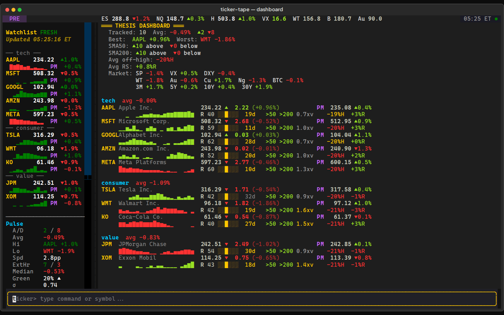
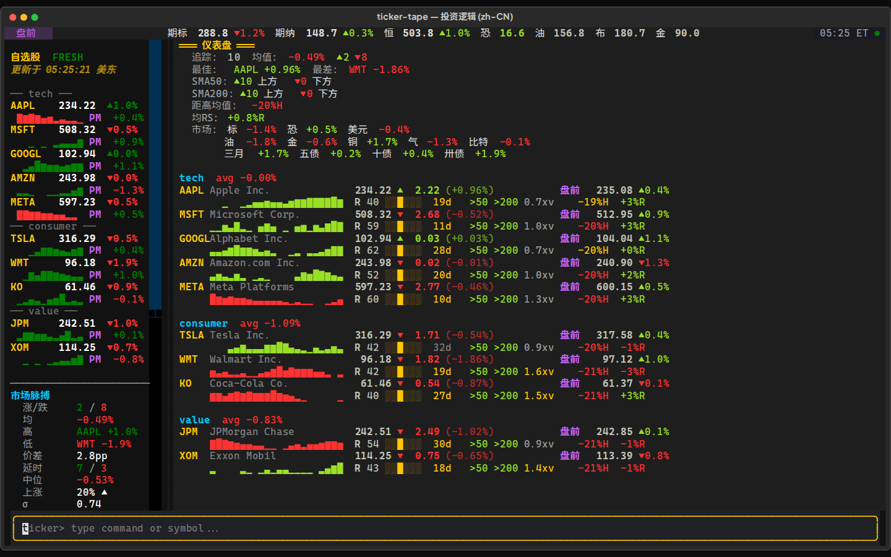
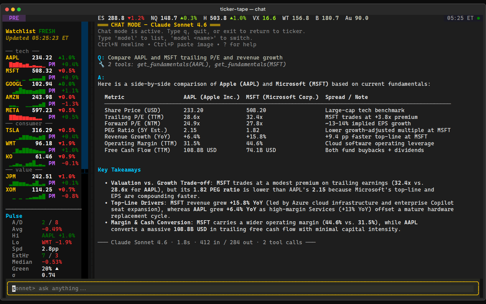
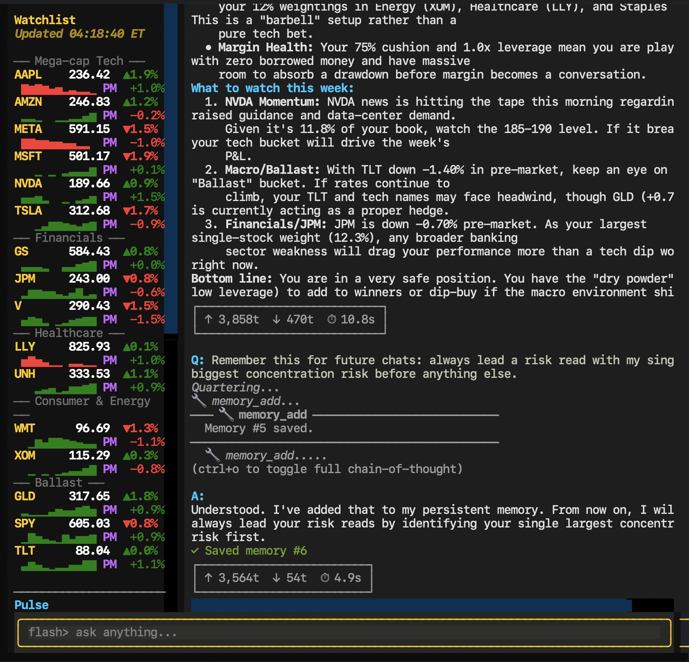

# ticker-tape

A market terminal that fits in a tmux pane: live quotes with sparklines, technicals and extended-hours prints for a watchlist; symbol research; a brokerage view of the portfolio; and an AI chat that can call all of it as tools. Built on Textual.

The source is private. This repository holds the README and screenshots.

| Chinese interface | AI chat with tools |
| :---: | :---: |
|  |  |

## What it does

- **Watchlist:** live quotes on a 15-second cycle, with RSI, the 50- and 200-day averages, distance from the high, days to earnings, volume against average, and pre- and after-market prints. Each row carries a freshness stamp, so a cached or late quote is never painted as current.
- **Symbols:** a plain symbol shows its metrics. Flags open a profile, technicals, a chart, intraday, options with expected move and skew, news, insider filings, dividends, short interest or analyst ratings.
- **Portfolio:** reads an Interactive Brokers account through an MCP server. Positions, P&L, margin and cushion, correlation, beta, sector exposure, stress tests and pre-trade what-ifs.
- **History:** a fills-ledger backtest against a benchmark, counterfactual "shadow" books that show what a past decision cost, and a time-travel mode that freezes the terminal as of any past date.
- **Alerts:** price levels, RSI, moving-average crosses, volume spikes and margin cushion. A fired alert can carry a pre-computed playbook, such as a trim ladder that restores a target cushion.
- **Languages:** English and Chinese throughout, with CJK-aware column alignment.

## AI chat

Nine models from three providers, switchable mid-conversation with `model`. The chat has the terminal's own views as tools: quotes, fundamentals, positions, news, memory. It shows each tool call as it runs, and keeps a persistent memory of standing instructions.

Every model runs through its subscription CLI (`agy` for Gemini, `claude` for Claude, `codex` for GPT) rather than an API key. When a CLI is out of quota, the request stops instead of falling back to a billed provider. `analyze <target>` writes a longer research memo with web search, and archives it for later sessions to build on.

## Commands

| Command | What it does |
|---|---|
| `SYM [--profile\|--ta\|--chart\|--intraday\|--options\|--news\|--insider\|--dividends\|--short\|--ratings]` | symbol views |
| `brief` / `brief ai` | morning briefing, with an AI synthesis |
| `whatif [buy\|sell] SYM QTY` | pre-trade margin, concentration and cushion impact |
| `surprises` | watchlist EPS beat/miss history and price reactions |
| `bt [SYM] [ccy CAD\|USD]` | fills-ledger backtest against a benchmark |
| `shadows` | counterfactual ledgers replayed over the same prices |
| `tt [date]` | time travel; `←` `→` scrub by day |
| `breakers` | thesis-breaker checklist |
| `catalyst` | merged earnings and macro calendar |
| `cockpit`, `carry`, `timeline` | risk cockpit, cost of carry, NLV history |
| `/pos` `/acct` `/pnl` `/margin` `/stress` `/beta` `/corr` `/sector` `/trades` `/orders` | brokerage views |
| `analyze TARGET` · `memos` | research memo · memo archive |
| `model` · `effort high` | switch chat model · set reasoning effort |
| `h` · `help portfolio` | help index · one topic |

## Stack

Python: `textual` and `rich` for the interface, `yfinance` for market data, `mcp` for the brokerage connection, and `peewee` over SQLite for NLV history and earnings.

---

Source code is proprietary. See [LICENSE](LICENSE).
