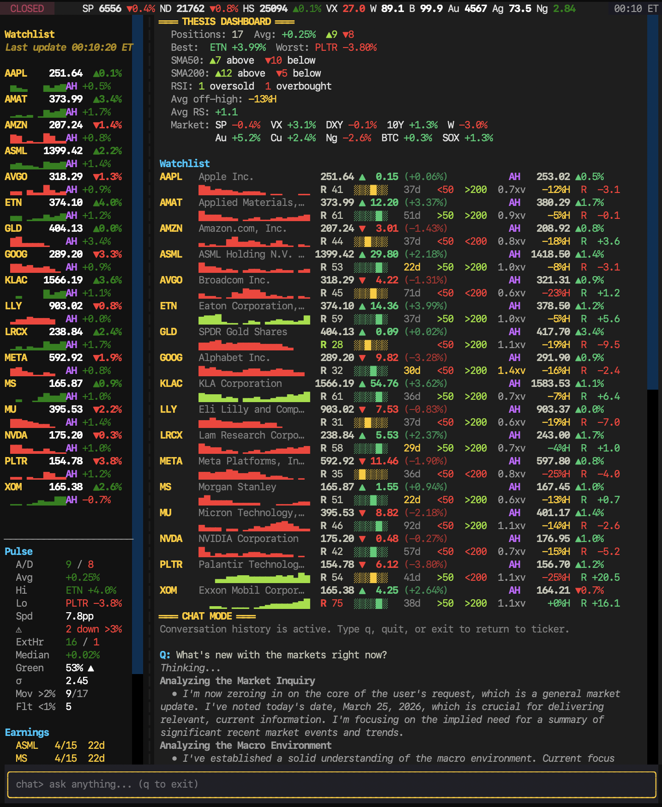

# ticker-tape

Financial data terminal: quotes, thesis-driven portfolio views, technicals, AI chat and IBKR portfolio integration in a Textual TUI.



## Install

The Python sources and tests are encrypted with git-crypt (see `.gitattributes`),
so running the app needs an unlocked checkout.

```sh
python3 -m venv venv
venv/bin/pip install -e .
venv/bin/ticker-tape          # the terminal app
./tape --help                 # headless CLI; same as venv/bin/ticker-tape-cli
```

Python 3.10 or newer. `ticker-tape --demo` (or `TICKERTAPE_DEMO=1`) runs on a fake
market and account from `data/demo/`, with no network. Demo mode sanitizes the system prompt of real context and seeds
NLV history, alerts, a memo and chat history.

## Usage

Type commands at the `ticker>` prompt. `h`, `help` or `?` opens an index;
`help symbols|market|watchlist|portfolio|research|chat|keys` gives a focused
reference and `help all` lists every topic.

Symbol views take flags: `SYM --profile`, `--ta`, `--chart`, `--intraday`,
`--options`, `--news`, `--insider`, `--dividends`, `--short`, `--ratings`,
`--impact`. A plain symbol shows metrics only. Existing view aliases continue to
work. `--insider` shows type, value and shares.

| Command | Does |
|---------|------|
| `brief` / `brief ai` | Morning briefing, with AI synthesis |
| `whatif [buy/sell] SYM QTY` | IBKR what-if: margin, concentration, cushion |
| `surprises` | Watchlist EPS beat/miss history, price reaction and beat streaks |
| `bt [SYM] [ccy CAD\|USD]` | Replay `data/fills.csv` against a benchmark (`docs/backtest.md`) |
| `python flex_import.py <export.csv>` | Seed the ledger from an IBKR Flex Query export |
| `shadows` | Replay counterfactual ledgers in `data/shadows/*.csv` |
| `tt [date]` | Freeze the terminal as of a past date; `←`/`→` scrub, `Home` returns |
| `breakers` / `tw` | Render an external thesis-breaker checklist (read-only); health headline is INTACT or BREACHED |
| `note` | One-line notes on fills |
| `spark vol` / `spark price` | Volume or price sparklines (persisted) |
| `layout pulse calendar pnl risk` | Sidebar sections and order, persisted; `layout add earnings`, `layout rm risk`, `layout reset` |
| `wire top` / `wire latest` | Rank the news-wire feed by priority or newest first (persisted) |
| `event fomc\|N\|SYM` | Calendar row workspace |
| `sig add NAME RULE… [rank FIELD]` | Saved rule sets over technicals, run over the watchlist |
| `opt SYM` | Options chain with expected move, IV, skew, term structure |
| `catalyst` / `cx` | Catalyst calendar merged with the macro calendar; `catalyst SYM` filters to one name |
| `cockpit` / `hf`, `carry`, `timeline`, `impact` | Risk, cost of carry, NLV history, earnings reactions |
| `alert`, `wl`, `memory`, `history`, `journal`, `resume` | Alerts, watchlist, chat memory (`memory ID` shows one in full; `add`, `delete`, `compact`), chat history, journal, resume |
| `copy [N]` | Copy the current screen to the clipboard; `copy 20` copies the last 20 lines |
| `/pos` `/acct` `/pnl` `/risk` `/trades` `/orders` `/detail SYM` `/margin` `/stress` `/beta` `/corr` `/sector` `/ibkr` | IBKR views; `/ta SYM` feeds technicals to chat |

Deep-dive memos: `analyze <target>` (alias `dive`) writes to
`data/analyses/{slug}/{YYYY-MM-DD-HHMMSS}.md` with YAML front-matter. Targets are a
symbol, a thesis key from config, or quoted freeform text; an angle hint may follow
a symbol (`analyze MSFT earnings`) and is recorded in the memo banner and front-matter.
Memos run on Gemini 4 Argon (the chat default) with application tools and subscription web search. `memos [SLUG]`,
`memo N` and `memo latest [SLUG]` reopen archived memos from disk.

Chat: `model [name]` lists or switches models, `effort [low|medium|high|xhigh]`
sets reasoning effort (no argument shows the active model's effort and supported
levels; works in command and chat mode; applies to subsequent requests),
`fast [on|off]` sets Codex Fast mode for GPT models, which uses more subscription
quota ([Codex speed settings](https://learn.chatgpt.com/docs/agent-configuration/speed)).
Model API ids: gemini-4-argon, gemini-3.8-flash, claude-sonnet-5-5, claude-opus-5-5,
claude-fable-5-1, gpt-6.1-sol, gpt-5.6-terra, gpt-6-luna, gpt-6-astra.
Chat and analysis run only through subscription CLIs: `agy` (Gemini), `claude`
(Claude), `codex` signed in with ChatGPT (GPT). Sign in to each first. Missing
login or quota stops the request; there is no API-key fallback. The AI can call
local tools (quotes, technicals, news, alerts, memory, memos, read-only IBKR
views); `set_alert` writes to the same store as the `alert` command; IBKR tools are whitelisted to read operations and cannot place orders.

| Key | Context | Action |
|-----|---------|--------|
| `F1` `F2` `F3` `F4` | Anywhere | Help / dashboard / markets / earnings |
| `PgUp` `PgDn`, `Ctrl+Home` `Ctrl+End` | Anywhere | Page output; first / latest output |
| `Ctrl+O` / `Ctrl+T` | Chat | Toggle chain-of-thought / generation footer |
| `Ctrl+P` | Chat | Paste clipboard image (macOS) |
| `Ctrl+N` | Chat | New line in input |
| `c` / `Ctrl+K` | Ticker | Toggle compact mode |
| `l` | Ticker | Switch language (en/zh) |

## Configuration

Copy `.env.example` to `.env`.

| Variable | Meaning |
|----------|---------|
| `TICKER_SYMBOLS` | Comma-separated watchlist |
| `IBKR_MCP_URL` | IBKR MCP endpoint (streamable HTTP) |
| `TICKERTAPE_AGY_HOST` | SSH host with an authenticated `agy`, if Gemini runs remotely |
| `CHAT_MODEL` | Default chat model |
| `TICKERTAPE_MAX_IMAGE_BYTES` | Per-image cap for chat images (default 2 MB) |
| `TICKERTAPE_DEMO` | `1` enables demo mode |

The carry rates `MARGIN_RATE_PCT`, `CASH_YIELD_PCT` and `FX_CARRY_PCT` are
env-overridable; the benchmark (`config.RS_BENCHMARK`) and report currency
(`config.BACKTEST_CCY`) are set in `config.py`. State persists under `data/` (gitignored
except `data/demo/`). Image input: GPT and Claude runtimes only.

## Tests

```sh
venv/bin/python scripts/validate_offline.py --self-check
venv/bin/python scripts/validate_offline.py -- tests -q
venv/bin/python -m pip wheel --no-deps --wheel-dir dist .
```

The launcher strips credentials, disables dotenv, redirects home and temp
directories and blocks network before collection. Run it from an unlocked
checkout; a worktree may fail checkout while encrypted files cannot be decoded.
Do not copy decryption keys to other hosts.

## License

See `LICENSE`.
